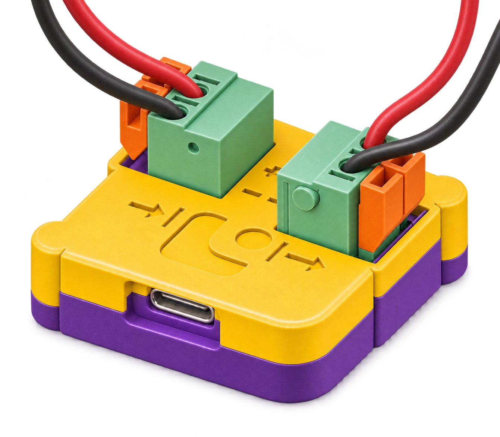

<h1 align="center">voloo</h1>

<p align="center"><b>A power switch you can program.</b><br>
Control the USB-C voloo Switch from a CLI, an AI agent (MCP), a local HTTP API or a web dashboard.</p>

<p align="center">
  <a href="https://github.com/librezoo/voloo/actions/workflows/ci.yml"></a>
  <a href="https://www.npmjs.com/package/@librezoo/voloo"></a>
  <a href="https://github.com/librezoo/voloo/releases/latest"></a>
  <a href="LICENSE"></a>
  
  
  
  
</p>

<p align="center">
  <br>
  <sub>AI-assisted product rendering</sub>
</p>

One `voloo` program talks to every Switch over its own USB cable. No driver is
needed on macOS, Linux or Windows 10/11.

> **voloo only switches externally supplied power; it is not a power source.**
> OFF does not mean the load terminals are at zero volts. Use `discharge` to
> confirm VOUT ≤ 1 V.

<p align="center">
  <a href="https://voloo.librezoo.com/">Website</a> ·
  <a href="docs/user-guide.en.md">User guide</a> ·
  <a href="docs/user-guide.md">中文使用说明</a> ·
  <a href="docs/reference.md">Reference</a> ·
  <a href="#community">QQ 技术交流群</a> ·
  <a href="CHANGELOG.md">Changelog</a>
</p>

## Get the hardware

[Buy the voloo Switch on Taobao · 淘宝购买](https://item.taobao.com/item.htm?id=1100678463979), or scan the code in the Taobao app.

<a href="https://item.taobao.com/item.htm?id=1100678463979"></a>

## Install

Requires Node.js 18 or newer.

```sh
npm install -g @librezoo/voloo@latest
```

To update, run the same command, then restart the background process once so it
also runs the new version:

```sh
voloo daemon stop
voloo ls
```

If npm reports a permission error (EACCES), do not use `sudo`; see the
[install help](https://voloo.librezoo.com/#start) on the website.

### Tab completion

Run the line for your shell. To enable completion in new terminals, add the
same line to your shell startup file.

| Shell | Enable in the current session | Startup file |
| --- | --- | --- |
| Bash | `eval "$(voloo completions bash)"` | `~/.bashrc` (`~/.bash_profile` for login shells) |
| Zsh | `source <(voloo completions zsh)` | `~/.zshrc` |
| Fish | `voloo completions fish \| source` | `~/.config/fish/config.fish` |
| PowerShell | `voloo completions powershell \| Out-String \| Invoke-Expression` | `$PROFILE` |

Try `voloo firmware update ` then Tab for a device UID, nickname, or `--all`.
After a device, Tab completes the local firmware file path. `voloo firmware inspect `
also completes paths. Tab after `voloo diag --kind ` offers the allowed values.
Run `voloo ls` to populate device nicknames for completion. Nickname completion
accepts letters, numbers, spaces, `-`, `_` and `.`.
Complete serial ports with `--port`, log UIDs with `voloo log --uid ` and recent
transaction IDs with `voloo trace `.
Use PowerShell or Git Bash on Windows for programmable completion.

## Quick start

```sh
voloo ls                 # connected devices, state and active faults
voloo name DEV bench-a   # optional nickname; DEV is a UID or nickname
voloo on bench-a         # switch on and confirm by reading status back
voloo discharge bench-a  # switch off and confirm VOUT ≤ 1 V
voloo ui                 # live web dashboard
voloo demo               # the dashboard with simulated devices, no hardware
```

Every power command is confirmed by reading the device state. A lost
acknowledgement is never answered by resending a command; the result is either
confirmed or reported as unknown. Add `--json` for machine-readable output. See
the [reference](docs/reference.md) for all commands, exit codes, the HTTP API,
configuration and logs.

## AI agents (MCP)

Any MCP client that runs a stdio server uses the same command:

| Client | Setup |
| --- | --- |
| Claude Code | `claude mcp add voloo -- voloo mcp` |
| Codex | `~/.codex/config.toml`: `[mcp_servers.voloo]` `command = "voloo"` `args = ["mcp"]` |
| Cursor, Windsurf, Cline, VS Code, Gemini CLI, … | `{"command": "voloo", "args": ["mcp"]}` |

Tools: `voloo_list_devices`, `voloo_get_status`, `voloo_power` (on, off, discharge,
cycle), `voloo_set_nickname`, `voloo_get_log`. Set `[mcp] read_only = true` in the
[configuration](docs/reference.md#configuration) to let agents read but not switch.
Tested clients are listed in [MCP client compatibility](docs/mcp-client-compatibility.md).

## Firmware

`voloo firmware update DEV` installs the newest published firmware that fits the
device and the installed voloo, verifies its checksum and the result, and keeps
the previous image for `voloo firmware rollback DEV`. The device must be idle
and OFF with valid measurements and VOUT ≤ 1 V. See
[firmware updates](docs/firmware-updates.md) for the limits and recovery steps.

## Documentation

| | |
| --- | --- |
| [User guide](docs/user-guide.en.md) · [中文](docs/user-guide.md) | Wiring, first use, dashboard, troubleshooting |
| [Quick start](docs/quick-start.en.md) · [中文](docs/quick-start.md) | Two-page wiring and first-use sheet |
| [Reference](docs/reference.md) | Commands, exit codes, HTTP API, configuration, logs, how the background process works |
| [Firmware updates](docs/firmware-updates.md) · [中文](docs/firmware-updates.zh.md) | Updating, rollback, recovery |
| [Changelog](CHANGELOG.md) · [Release notes](docs/releases/) | What changed in each version |
| [Security](SECURITY.md) | Reporting vulnerabilities |

## Community

[加入 voloo 技术交流 QQ 群](https://qm.qq.com/q/3dPDKPKEqc)，一起交流使用经验、提问和反馈问题。也可以用手机 QQ 扫描下方二维码。

<a href="https://qm.qq.com/q/3dPDKPKEqc"></a>

## Development

```sh
cargo build --release   # target/release/voloo
cargo test              # simulated devices only; never touches real hardware
cargo fmt --check && cargo clippy --all-targets -- -D warnings
node --test packaging/npm/publish.test.mjs tests/web.test.mjs
```

| Path | Contents |
| --- | --- |
| `src/` | The single Rust implementation: CLI, background process, MCP, HTTP API, serial link, firmware updates |
| `web/` | The dashboard (static files served by the program) |
| `tests/` | Integration tests with a simulated device |
| `packaging/` | npm and PyPI packaging |
| `firmware/x035/` | Firmware manifest and GitHub Release publishing instructions |

Other languages integrate through the HTTP API, `--json` or MCP rather than separate
SDKs. Commits follow [Conventional Commits](https://www.conventionalcommits.org/)
and versions follow [Semantic Versioning](https://semver.org/).

## License

[Apache-2.0](LICENSE)
