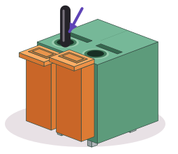

# voloo quick start

[Two-page A4 PDF](assets/voloo-quick-start-en.pdf) · [Full English guide](user-guide.en.md) · [中文快速上手](quick-start.md) · [Website](https://voloo.librezoo.com/index.en.html)

**3.3–28 V DC nominal; 3 A maximum recommended. Higher current can damage hardware. voloo does not regulate voltage or actively limit current: match the device voltage and set an external current limit.**

## Connect three things

1. Independent **supply A → IN / SOURCE**. Measure actual polarity before connecting voloo, then turn the supply OFF before wiring to the physical + / − markings. Reversed polarity damages hardware.
2. **OUT / DUT → device**. The device must take power only from OUT. Disconnect its other USB, battery and debugger power.
3. **Computer → USB-C**, using a data cable. Power the computer from independent **supply B**. Different ports on one multiport adapter do not count as independent supplies.


Color is only an aid. Follow physical markings and measured polarity. Product appearance is an AI-assisted rendering.

## Press orange, wire into green

The orange actuator opens the wire clamp; **it is not the power switch**. Make both ends unpowered before handling wires. If residual voltage remains, keep USB connected and discharge until VOUT ≤ 1 V is confirmed, then turn off and disconnect the external supply, unplug USB-C, and verify both ends are unpowered.

1. Strip untreated wire **11 mm** per the [manufacturer drawing](https://www.lcsc.com/datasheet/C475134.pdf). Keep strands together and check prepared ends fit.
2. Hold the matching orange actuator **toward the circuit board**.
3. Keep pressing and fully insert the conductor into the adjacent **green round hole**.
4. Release, then gently tug to check the grip. No bare copper outside.




To remove, make both ends unpowered, hold orange and withdraw gently along the entry direction. Do not yank or pry. Diagrams are not to scale or fixed polarity positions.

## Install and open

Install Node.js 18 or newer (current LTS recommended), then run:

```sh
npm install -g @librezoo/voloo
voloo ui
```

Connect only the target voloo first. Confirm it appears with output OFF. Check wiring and limits, then enable the independent DC supply. Confirm the device can safely lose power, then press and hold the dashboard switch. A short press does not switch power.

OFF does not mean 0 V. Use **Discharge** and confirm VOUT ≤ 1 V. If a result is unknown, read the state before another action; do not blindly repeat a command. After overvoltage clears, output stays OFF until you explicitly switch it ON again. No extra overvoltage reset command is needed.

Missing device? Try a USB data cable and run `voloo doctor`. No hardware yet? Run `voloo demo`. QR codes on both language versions point to the same website, with a language switch and guides.
