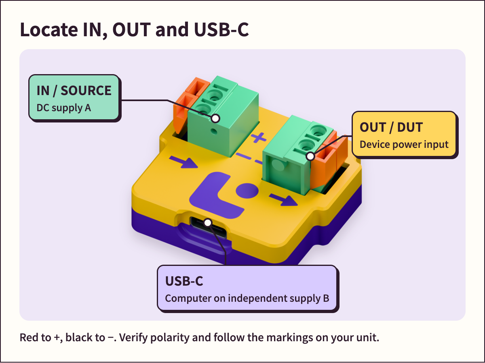
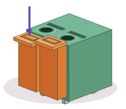

# voloo quick start

[Two-page A4 PDF](assets/voloo-quick-start-en.pdf) · [Full English guide](user-guide.en.md) · [中文快速上手](quick-start.md) · [Website](https://voloo.librezoo.com/index.en.html)

**3.3–28 V DC nominal; 3 A maximum recommended. Higher current can damage hardware. voloo does not regulate voltage or actively limit current: match the device voltage and set an external current limit.**

## Connect the supply, device and computer

1. Independent **supply A → IN / SOURCE**. Measure actual polarity before connecting voloo, then turn the supply OFF before wiring to the physical + / − markings. Reversed polarity damages hardware.
2. **OUT / DUT → device**. The device must take power only from OUT. Disconnect its other USB, battery and debugger power.
3. **Computer → USB-C**, using a data cable. Power the computer from independent **supply B**. Different ports on one multiport adapter do not count as independent supplies.



Use wire colors as a guide, but always check the markings on your unit and measure the actual polarity.

## Connect the wires

The orange tabs release the wire clamps; **they do not switch power**. Do not handle wires while either side is powered. If residual voltage remains, keep USB connected and discharge until VOUT ≤ 1 V is confirmed, then turn off and disconnect the external supply, unplug USB-C, and verify both ends are unpowered.

1. Strip **5–11 mm** of insulation, if needed. Keep the strands together. Check that any pre-fitted wire end fits the terminal.
2. Hold the matching orange tab **toward the circuit board**. If you wear nail extensions, press carefully with the pad of your finger.
3. Keep pressing and fully insert the conductor into the adjacent **round wire opening in the green terminal**.
4. Release, then gently tug to check the grip. Check that no bare copper is exposed.




To remove a wire, disconnect all power, hold the matching orange tab and gently pull the wire straight out. Do not force the wire or pry the tab. The diagrams are not to scale and do not specify polarity positions.

## Install the software

Install Node.js 18 or newer (current LTS recommended), then run:

```sh
npm install -g @librezoo/voloo@latest
voloo ui
```

Start with just the voloo you want to control. Check that it appears in the dashboard with its output OFF. Verify the wiring, supply voltage and current limit, then turn on the external DC supply. Once you have confirmed it is safe to switch the device off and on, press and hold the dashboard switch. A quick tap will not change the output.

OFF does not mean 0 V. Use **Discharge** and confirm VOUT ≤ 1 V. If a result is unknown, read the state before another action; do not blindly repeat a command. After overvoltage clears, output stays OFF until you explicitly switch it ON again. No extra overvoltage reset command is needed.

Missing device? Try a USB data cable and run `voloo doctor`. No hardware yet? Run `voloo demo`. QR codes on both language versions point to the same website, with a language switch and guides.
