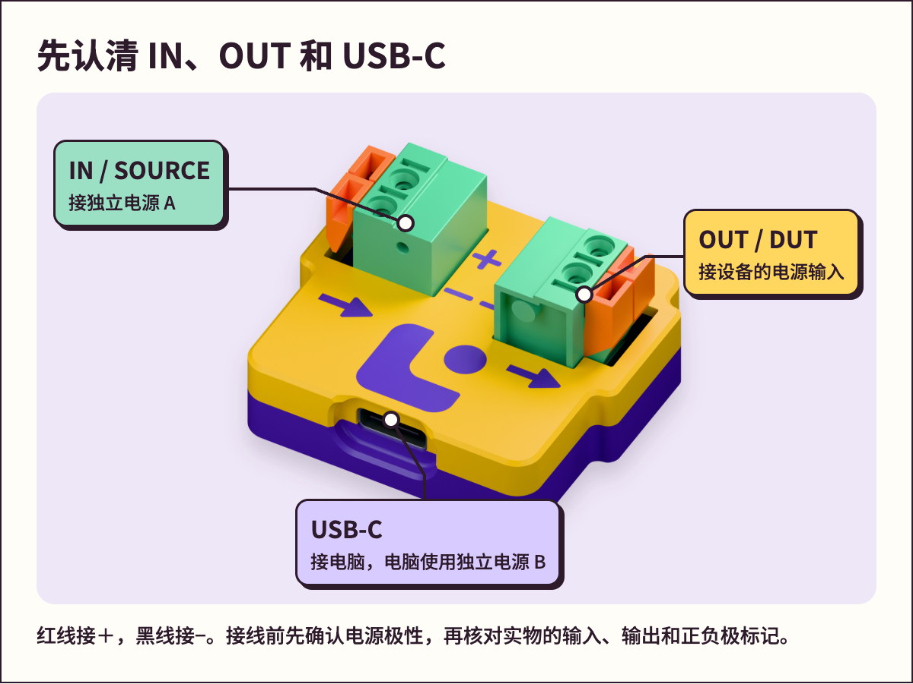
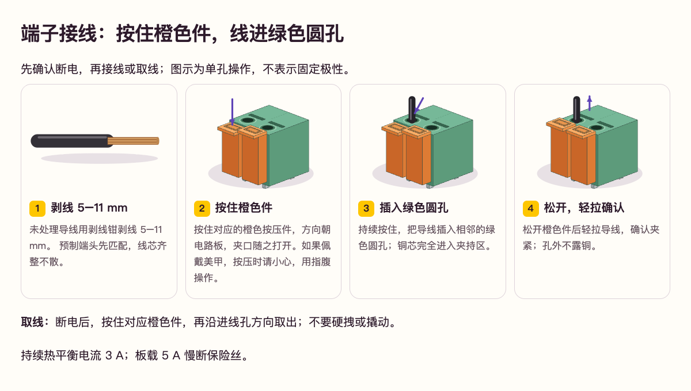

# voloo 快速上手

[下载 A4 两页快速说明书](assets/voloo-quick-start-zh.pdf) · [完整中文说明](user-guide.md) · [English quick start](quick-start.en.md) · [voloo 官网](https://voloo.librezoo.com/)

海报、长图和快速说明书的二维码统一指向 voloo 官网，安装入口与中文使用说明均可从官网进入。

**标称 3.3–28 V 直流；持续热平衡电流 3 A。板载慢断保险丝额定 5 A，该值不代表整机瞬时上限。voloo 不调压，外部电源电压必须匹配设备，并设置合适限流。**

## 接好三处

1. **独立直流电源 A → IN / SOURCE**。未接 voloo 时，用万用表测清电源极性；关闭输出后再接线。
2. **OUT / DUT → 设备**。按实物＋／−标记连接，设备只从 OUT 取电，断开它的其他供电。
3. **电脑 → USB-C**。使用支持数据传输的 USB 线，电脑由另一独立电源 B 供电。不要与设备共用同一适配器，不同输出口也不行。

图示按**红线接＋、黑线接−**配线；颜色只作辅助，不能代替实际极性测量与实物标记。



## 橙色件负责夹线，不是电源开关

只在断电后接线或取线。如设备有残压，先保持 USB 连接执行泄放并确认 VOUT ≤ 1 V；再关闭并断开外部电源、拔下 USB-C，确认两端无电后操作。

1. 未处理导线用剥线钳剥线 **5–11 mm**，线芯整理齐，不留散丝；预制端头先确认匹配。
2. 按住对应橙色按压件，方向朝电路板，使夹口打开。如果佩戴美甲，按压时请小心，用指腹操作。
3. 持续按住，把线插入相邻的**绿色圆孔**，铜芯完全进入夹持区。
4. 松开后轻拉确认夹紧，孔外不露铜。



**取线：** 确认断电后，按住对应橙色件，沿进线孔方向取出。不要直接硬拽、撬动按压件或拆下整个端子。

## 安装并完成第一次控制

电脑先安装 [Node.js](https://nodejs.org/) 18 或更新版本，再在终端执行：

```sh
npm install -g @librezoo/voloo@latest
voloo ui
```

1. 首次只连接目标这台 voloo，确认它出现在浏览器仪表盘且输出为 OFF。
2. 核对接线、标称电压与限流后，再打开独立直流电源输出。
3. 确认设备允许断电后，在仪表盘长按开关控制供电；短按不切换。
4. OFF 不等于 0 V。需要放掉残压时用「泄放」，确认 VOUT ≤ 1 V；结果未知时先检查状态，不盲目重试。

没有硬件可先运行 `voloo demo`。Agent、脚本和故障处理方法见[完整说明](user-guide.md)。

端子型号与结构见 [KEFA KF142V-5.08 厂家图纸（立创 C475134）](https://www.lcsc.com/datasheet/C475134.pdf)。元件规格不改变 voloo 的整机使用范围。操作图为结构示意。
