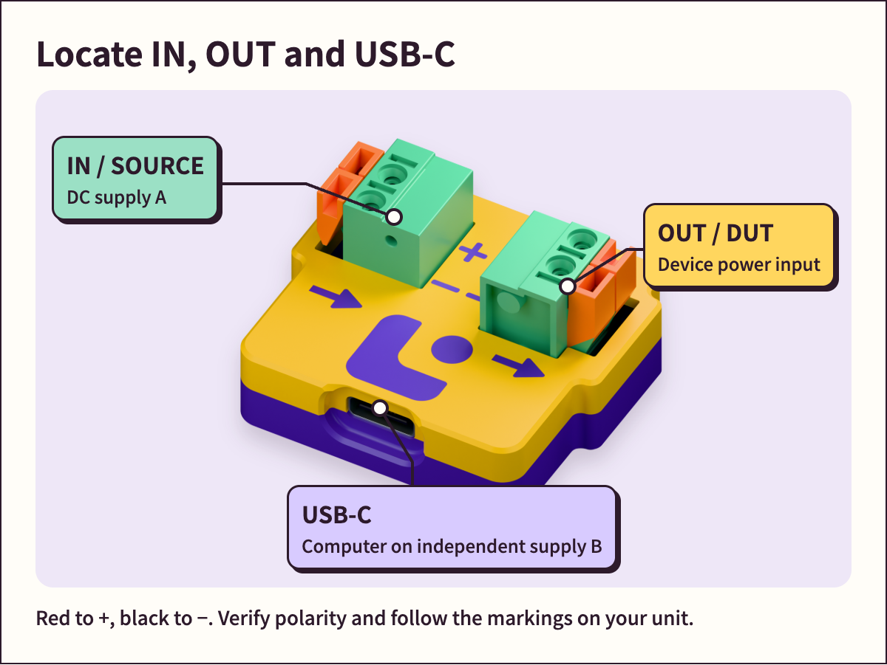
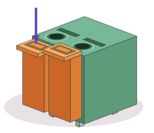
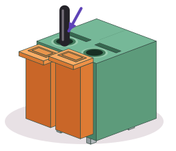
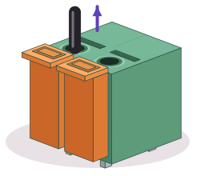

# voloo user guide

[中文图文说明](user-guide.md) · [Illustrated quick start](quick-start.en.md) · [Website](https://voloo.librezoo.com/index.en.html)

voloo lets you control a device's DC power from your computer over USB. Connect
your external supply to IN / SOURCE and your device to OUT / DUT, then connect
voloo to your computer with a USB data cable. USB provides control; the external
supply powers your device. voloo is a switch, not a power supply.

Three things to keep in mind:

- **Off is not 0 V.** Turning the output off disconnects the supply, but the load can
  keep its charge. **Discharge** turns off and actively drains the load until VOUT ≤ 1 V
  is confirmed.
- **A reading of “—” or “unreadable” is invalid, never zero volts.**
- **If a result is “unknown”, read the state before doing anything else.** voloo never
  repeats a power command on its own after a lost reply.

## Tested operating range and overvoltage protection

The nominal input range is **3.3–28 V DC**. Operation with a **3 A constant-current load** in this range has been tested. The **continuous current rating at thermal equilibrium is 3 A**. The onboard **5 A time-delay fuse** has a component rating; it does not specify the unit’s peak current limit. This condition does not establish support for arbitrary inrush, inductive backfeed, all-temperature or indefinite enclosed operation.

Load power is `P = V × I`: 3.3/5/12/24/28 V at 3 A correspond to 9.9/15/36/72/84 W. The 84 W value describes the 28 V, 3 A operating point, not a voltage-independent power rating. voloo does not regulate voltage or provide programmable current/power limiting; set appropriate limits on the external supply.

When a valid VIN reading exceeds **30.5 V**, voloo switches the output OFF and latches overvoltage protection. Once a valid reading falls below **30.0 V**, **the latch clears automatically, but the output stays OFF**.

To restore power, first return to the 3.3–28 V operating range and check the wiring and current limit. Then press and hold **Switch On** in the dashboard, send a new `voloo on DEV` command, or ask your agent to switch that device on. **No separate overvoltage reset command is needed.** voloo never automatically restores the previous ON state or retries a rejected command.

Overvoltage protection is separate from the operation lock set with `voloo lock`: `voloo unlock` does not clear an overvoltage condition. Invalid or stale VIN readings also prevent the output from turning on and switch an active output off. An overvoltage shutdown does not discharge the output automatically.

These thresholds use software voltage measurements. They are not guaranteed physical clamp voltages or response times, and they do not extend the 28 V nominal upper limit.

## Before connecting power



- **Reversed supply polarity damages the hardware.** Verify + / − before wiring and turn the supply output off before connecting it.
- **Do not power both the load supply and the USB host computer from the same adapter.** Use independent supply A for voloo IN / the load and another independent supply B for the operating computer. Different output ports on one multiport adapter do not count as independent supplies. Do not take load power from the host computer's USB port.
- **Size the continuous load for 3 A at thermal equilibrium.** For example, a continuous 4 A load at 12 V exceeds the continuous rating even at 48 W. Set the external supply current limit for the load. Assess inrush separately using peak amplitude, pulse duration, repetition interval and cooling.

## Spring-terminal wiring and removal

The orange tabs release the wire clamps; **they do not switch power**. Use the dashboard, CLI or agent to control power. Leave the terminals attached to voloo. There are no screws to loosen.

**Do not handle the wires while either side is powered.** If residual voltage remains, keep USB connected and discharge until VOUT ≤ 1 V is confirmed. Then turn off and disconnect the external supply, unplug USB-C, and confirm that neither the input nor the device side has power.

1. **Strip 5–11 mm** of insulation from the wire, if needed. Keep the strands together. Check that any pre-fitted wire end fits the terminal.
2. **Press and hold** the matching orange tab **toward the circuit board** to open the clamp. If you wear nail extensions, press carefully with the pad of your finger.
3. **Keep pressing and insert** the conductor fully into the adjacent **round wire opening in the green terminal**. Orange openings and narrow green slots are not wire entries.
4. **Release, then gently tug** to check the grip. Check that no bare copper is exposed outside the terminal.







To remove a wire, disconnect all power first. Hold the matching orange tab and gently pull the wire straight out. Do not force the wire or pry the tab. The diagrams show how the clamp works; they do not specify which terminal is positive or negative. Follow physical IN / OUT and + / − markings: the illustrated leads use red for positive and black for negative. Component ratings do not change the system limits of **3.3–28 V DC and 3 A continuous current at thermal equilibrium**.

## 1. Install

Use a USB data cable (USB-A or USB-C to USB-C, USB 2.0 or 3.0).
The device uses system USB CDC drivers; no vendor-specific driver is required. Serial access may still need permission setup.

| With | Command |
| --- | --- |
| npm (Node 18+) | `npm install -g @librezoo/voloo@latest` (run it again to update, then `voloo daemon stop` and `voloo ls` to restart the background process) — or run without installing: `npx @librezoo/voloo@latest ls` |
| A downloaded binary | put `voloo` (`voloo.exe`) on your `PATH` |

On Linux, add yourself to the serial group once and log in again:
`sudo usermod -aG dialout $USER` (`uucp` on Arch). `voloo doctor` tells you if this is
needed.

No hardware yet? `voloo demo` opens the dashboard with simulated devices.

## 2. First steps

```sh
voloo ls                         # every connected voloo, its state and readings
voloo on bench-a                 # by nickname…
voloo off 5E-11-D0-00-00-00-00-01   # …or by UID
voloo discharge bench-a          # off, then drain the load to ≤ 1 V
voloo cycle bench-a --off-ms 2000   # discharge, wait 2 s, on
voloo name 5E-11-D0-00-00-00-00-01 bench-a   # nickname (output must be off)
voloo ui                         # dashboard in your browser
```

After each command, voloo checks the device state and reports the result. Add `--json` for
programs. Exit codes: `0` completed (or already in the requested state), `2` the device reported a failure,
`3` outcome unknown or not connected — check `voloo status` first, `4` bad argument or
device not found, `5` busy, locked or port in use.

A small background process owns the USB ports so that the terminal, the dashboard, AI
agents and your programs can all use a voloo at the same time. It starts by itself,
listens on 127.0.0.1 only, and exits 10 minutes after the last client. Starting or
stopping it never changes an output. `voloo daemon status` / `voloo daemon stop`.

## 3. Dashboard

`voloo ui` opens a one-time link (valid for 60 seconds) in your browser. Each device
shows its state, the output (VOUT) and input (VIN) voltages, the last minute of VOUT
and anything that needs attention.

- **Switch:** press and hold the switch icon (or a button in the device view) for about
  half a second. The blade closes as you hold; let go early and nothing happens.
- **Device view:** click a device for the larger readout, Discharge and Power Cycle,
  renaming, locking and details.
- **Lock:** a locked device refuses every change from every client — dashboard,
  terminal, AI agents and programs — until you unlock it. `voloo lock bench-a` /
  `voloo unlock bench-a` do the same from the terminal.
- **Unknown result:** power controls stay disabled until **Check state** reads fresh
  device state successfully. A lost browser connection never triggers an automatic retry.
- **Language and appearance:** choose English, 简体中文 or 繁體中文, and system,
  light or dark appearance in the header. Preferences are saved in this browser.

## 4. AI agents (MCP)

voloo provides a local stdio MCP server, started with `voloo mcp`. The entries below are configuration examples; file locations and approval settings depend on the client version.

| Tool | Setup |
| --- | --- |
| Claude Code | `claude mcp add voloo -- voloo mcp` |
| Codex CLI | `~/.codex/config.toml`: `[mcp_servers.voloo]` then `command = "voloo"` and `args = ["mcp"]` |
| Cursor | `~/.cursor/mcp.json`: `{"mcpServers": {"voloo": {"command": "voloo", "args": ["mcp"]}}}` |
| VS Code (Copilot) | Workspace-root `.mcp.json`: `{"mcpServers": {"voloo": {"type": "stdio", "command": "voloo", "args": ["mcp"], "tools": ["*"]}}}` |
| Gemini CLI | `~/.gemini/settings.json`: `{"mcpServers": {"voloo": {"command": "voloo", "args": ["mcp"]}}}` |
| Other local stdio MCP clients | configure the same `command` / `args` pair according to the client documentation |

Without a global install, clients that support executable arguments can use `command: "npx"` with `args: ["-y", "@librezoo/voloo", "mcp"]`. Configuration paths and executable lookup depend on the client and operating system.

The agent gets five tools: `voloo_list_devices`, `voloo_get_status`, `voloo_power`
(`on`, `off`, `discharge`, `cycle`), `voloo_set_nickname` and `voloo_get_log`. To give
agents read-only access, add this to `~/.voloo/config.toml`:

```toml
[mcp]
read_only = true
```

Tools that speak MCP over HTTP can use `http://127.0.0.1:<port>/mcp` with the header
`Authorization: Bearer <token>` (see the next section for both values).

## 5. Your own programs

Any language can use the local HTTP API. Get the address and token with
`voloo api-info --json` (this also starts the background process), or read
`~/.voloo/daemon.json`. The token changes whenever the process restarts, so read it at
startup. The full API is at `/openapi.json`; you can generate a client from it.

**Shell**

```sh
voloo --json status bench-a | jq .vout_mv
voloo on bench-a || echo "exit $? — see the table in section 2"
```

**Python** (standard library only)

```python
import json, subprocess, urllib.request, urllib.error

api = json.loads(subprocess.check_output(["voloo", "api-info", "--json"]))

def call(method, path, body=None):
    req = urllib.request.Request(api["url"] + path, method=method,
        data=json.dumps(body).encode() if body is not None else None,
        headers={"Authorization": f"Bearer {api['token']}", "Content-Type": "application/json"})
    try:
        with urllib.request.urlopen(req, timeout=120) as r:
            return json.load(r)
    except urllib.error.HTTPError as e:
        raise RuntimeError(json.load(e)["error"]) from None  # code, message, trace_id, faults

print(call("GET", "/v1/devices"))
r = call("POST", "/v1/devices/bench-a/power", {"action": "on"})
print(r["outcome"], r["status"]["vout_mv"])
```

**JavaScript** (Node 18+)

```js
import { execFileSync } from 'node:child_process';
const api = JSON.parse(execFileSync('voloo', ['api-info', '--json']));
const call = async (method, path, body) => {
  const res = await fetch(api.url + path, { method, body: body && JSON.stringify(body),
    headers: { Authorization: `Bearer ${api.token}`, 'Content-Type': 'application/json' } });
  const data = await res.json();
  if (!res.ok) throw Object.assign(new Error(data.error.message), data.error);
  return data;
};
console.log(await call('POST', '/v1/devices/bench-a/cycle', { off_ms: 1000 }));
```

**Java** (11+)

```java
var client = java.net.http.HttpClient.newHttpClient();
var req = java.net.http.HttpRequest.newBuilder(java.net.URI.create(url + "/v1/devices/bench-a/power"))
    .header("Authorization", "Bearer " + token).header("Content-Type", "application/json")
    .POST(java.net.http.HttpRequest.BodyPublishers.ofString("{\"action\":\"off\"}")).build();
var res = client.send(req, java.net.http.HttpResponse.BodyHandlers.ofString());
System.out.println(res.statusCode() + " " + res.body());
```

**C / C++** (libcurl)

```c
struct curl_slist *h = curl_slist_append(NULL, auth_header);  /* "Authorization: Bearer <token>" */
h = curl_slist_append(h, "Content-Type: application/json");
curl_easy_setopt(curl, CURLOPT_URL, "http://127.0.0.1:<port>/v1/devices/bench-a/power");
curl_easy_setopt(curl, CURLOPT_HTTPHEADER, h);
curl_easy_setopt(curl, CURLOPT_POSTFIELDS, "{\"action\":\"discharge\"}");
curl_easy_perform(curl);
```

**Live updates** come as server-sent events from `GET /v1/events` (`status`,
`device.added`, `device.removed`, `operation.finished`, `fault.raised`, …):
`curl -N -H "Authorization: Bearer $TOKEN" $URL/v1/events`.

HTTP status codes follow the exit codes: 400/404 bad request or not found, 409 busy or
locked, 502 the device reported a failure, 503 not connected, 504 outcome unknown (read
the state before acting). Requests must come from this computer; pages on other sites
cannot reach the API.

## 6. Settings

`~/.voloo/config.toml` (all optional):

```toml
idle_exit_s = 600                 # background process lifetime without clients
[mcp]
read_only = false                 # true: agents can read but not switch
[devices."5E-11-D0-00-00-00-00-01"]
locked = true                     # nobody can switch this device (lift it here)
[[ports]]                         # a port USB discovery does not report
path = "/dev/ttyUSB3"
uid = "5E-11-D0-00-00-00-00-01"
```

`VOLOO_HOME` moves everything (settings, logs, reports) to another directory.

## 7. Troubleshooting

| Symptom | What to do |
| --- | --- |
| Nothing listed | `voloo doctor`. Try another cable (charge-only cables have no data lines) or port. |
| “Port in use by another app” | Close the other program using the port (a browser serial page, another tool). |
| Offline / “Not responding” | The output keeps its last state. Reconnect the cable, then `voloo status`. |
| VIN or VOUT “unreadable” | Not 0 V. Check the SOURCE wiring and the board's ground connection. |
| “Discharge timed out” | Something keeps VOUT above 1 V (another supply, a large capacitor). Check the load. |
| Result unknown | `voloo status` first. Do not repeat the command blindly. |

`voloo faults` lists problems with the suggested next step. `voloo log` shows the
history of power operations, including where each command came from (CLI, dashboard, AI agent or API).

**Reporting a problem:** `voloo report` writes one file under `~/.voloo/reports/` with
versions, device states and registers, recent faults and logs, and your settings. It
contains no token, host name or user name, and nothing is sent anywhere; open it to
check it, then attach it to your message.

## USB firmware maintenance

Open a device's details in the dashboard and use **USB firmware**, or run:

```sh
voloo firmware status DEV
voloo firmware update DEV
voloo firmware update DEV /path/to/firmware.voloofw  # optional offline file
voloo firmware rollback DEV
```

Online updating downloads the encrypted firmware paired with this CLI release,
then deletes its temporary file after verification or handled failure. Use a
compatible device and the recommended package; contact support if it is refused.

The background process handles port ownership and reconnection automatically.
The output must already be OFF with valid readings and VOUT <= 1 V; locks still
apply, and the old ON state is never resumed. A/B trials are confirmed only after
identity, version, nickname and state verification; failed trials restore the
previous confirmed image. Read [firmware updates](firmware-updates.md) for prerequisites and recovery boundaries.

## 8. Building the packages (maintainers)

```sh
node packaging/npm/build.mjs                      # dist/npm: @librezoo/voloo + @librezoo/voloo-<platform>
(cd packaging/pypi && uvx maturin==1.15.0 build --release --out ../../dist/pypi)
sh packaging/check-install.sh                     # installs both into throw-away places and runs them
```

Each platform's binary is built on that platform (or in CI) and the platform packages
are published together with the `voloo` launcher package.
