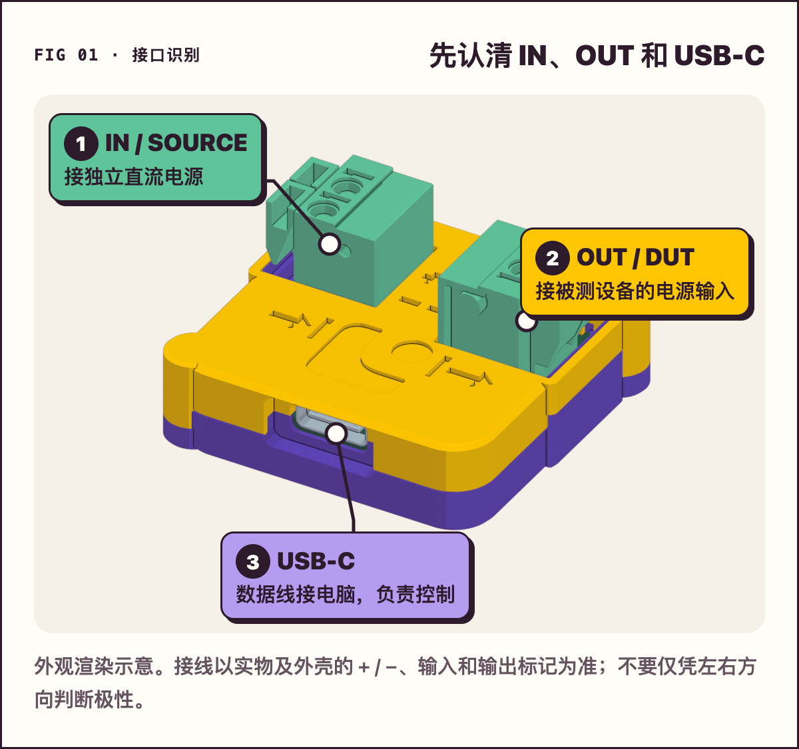
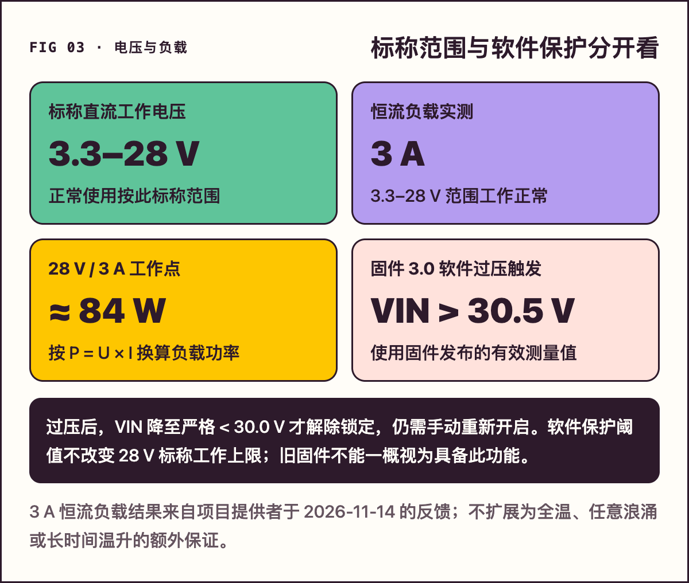
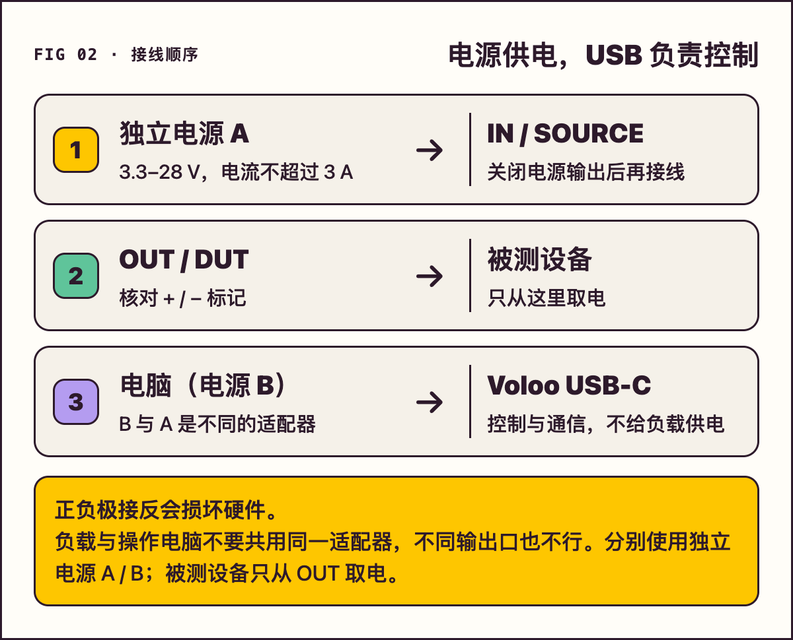
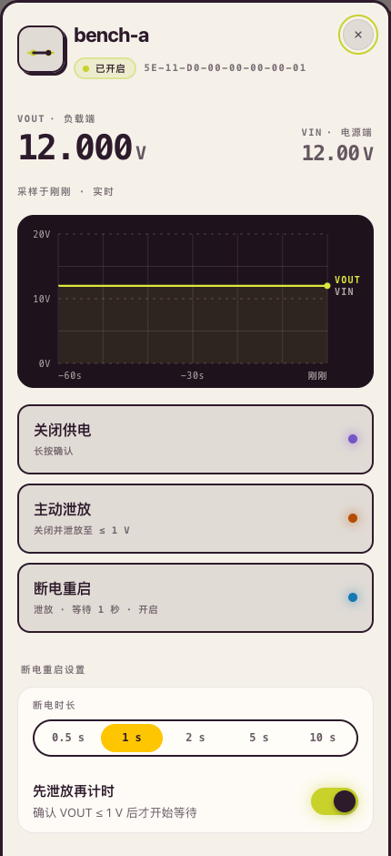

# Voloo 使用说明

中文图文版 · [English guide](user-guide.en.md)

Voloo 是一个由电脑控制的直流电源开关。把它接在独立直流电源和被测设备之间，再用 USB-C 数据线连接电脑，就能通过网页仪表盘、命令行、AI Agent 或本地 HTTP API 控制供电。

**Voloo 只切换你接入的电源，本身不是电源。** USB-C 负责控制，不负责给被测设备供电。本说明适用于 USB-C 连接的 Voloo，不适用于旧款 RS-485 设备。

**标称工作电压：3.3–28 V DC；3 A 恒流负载已实测工作正常。**

快速查阅：[安装体验](#1-安装和无硬件体验) · [接线和参数](#2-接线和上电) · [仪表盘](#4-用网页仪表盘控制) · [AI Agent](#6-接入-ai-agent) · [固件与过压保护](#7-确认固件版本和过压保护) · [常见问题](#9-常见问题)

## 先记住三件事

- **OFF 不等于 0 V。** 关断后，负载可能仍有残压。需要主动泄放时，使用 `discharge`，并以设备确认输出电压 ≤ 1 V 为完成条件。
- **无效读数不等于 0 V。** 界面显示“—”或 `unreadable`，以及 JSON 中的 `null`，都表示当前没有有效测量值。
- **结果未知时先查状态。** 遇到 `unknown`、断线或等待超时，先查询设备当前状态，不要盲目重发电源命令。等待超时也不表示设备动作已经取消。

## 1 安装和无硬件体验

支持 macOS 11 及以上、Linux、Windows 10/11。请先安装 Node.js 18 或更新版本，再在终端执行：

```sh
npm install -g @librezoo/voloo
voloo --version
```

安装后，命令名是 `voloo`。不想全局安装时，也可以用以下方式运行一次：

```sh
npx @librezoo/voloo ls
```

没有硬件也能先体验仪表盘：

```sh
voloo demo
```

`demo` 使用模拟设备，不扫描或控制真实硬件。退出演示不会切换真实设备的供电。

## 2 接线和上电

准备一根**支持数据传输**的 USB 线。只支持充电的线不能用于通信；电脑一端可以是 USB-A 或 USB-C。



*图 1：产品外观渲染及接口标注。接线以实物和外壳的正负极标记为准。*

| 接口 | 连接什么 |
| --- | --- |
| IN / SOURCE | 独立直流电源，按外壳的正负极标记连接 |
| OUT / DUT | 被测设备的电源输入，按正负极连接 |
| USB-C | 控制电脑，只承担控制与通信 |

### 电压 电流和功率边界

| 项目 | 当前参数与适用范围 |
| --- | --- |
| 标称工作电压 | **3.3–28 V DC** |
| 已验证负载工况 | **3 A 恒流负载**，用户反馈在 3.3–28 V 范围工作正常 |
| 负载功率 | 按 `P = U × I` 换算；28 V × 3 A ≈ **84 W**，是按该电压与电流换算的负载功率，不是脱离工况的统一功率额定 |
| 供电与限流 | Voloo 只做电源开关，不自动调压、限流或限功率；由外部电源设置合适的电流限制 |

本节依据项目提供者于 **2026-11-14** 反馈的实测结果更新。已确认的是 **3 A 恒流负载工况**；不要将它扩展成任意容性启动浪涌、感性回灌、全温或任意长时间运行条件的保证。不同线材、接线、外壳及环境条件仍需确认压降和温升。



*图 2：标称工作范围与保护阈值分开看。3.3 V 是标称下界，不是固件欠压阈值；28 V 是标称上界，不是软件过压触发点。*

以下为 **3 A 恒流负载**下的功率换算，便于按供电电压选择负载：

| 工作电压 | 电流 | 负载功率换算 |
| ---: | ---: | ---: |
| 3.3 V | 3 A | 9.9 W |
| 5 V | 3 A | 15 W |
| 12 V | 3 A | 36 W |
| 24 V | 3 A | 72 W |
| 28 V | 3 A | 84 W |

保险丝的标称电流不能代替整板工作参数或精确限流功能。

主动泄放用于已经断开外部供电的负载残压，不是给电池放电或吸收持续供电功率的电子负载。

### 接线顺序

**当前版本没有防反接，USB 与功率侧共地。** 接线时请按以下顺序操作：

1. 电源还未连接 Voloo 时，用万用表确认电源的正负极，再关闭电源输出。
2. 按外壳的输入、输出和 `+ / −` 标记接线，不要只凭观看方向判断端子左右。
3. SOURCE 使用独立直流电源，不要从同一台电脑的 USB 5 V 取电。
4. 被测设备只从 Voloo 的 OUT 取电。控制期间，断开它自带 USB、电池、调试器 VCC / 3V3 等其他供电。
5. 使用调试器或 USB 转串口时，只连接需要的 GND 和信号线，不接它们的供电输出。
6. 确认接线正确、电源适合被测设备后，再接上 USB 数据线并打开独立电源。



*图 3：独立直流电源给负载供电，USB-C 只负责控制。被测设备不再同时接入其他供电。*

多路供电可能让 OUT 被倒灌，造成关断后设备仍有电，甚至损坏设备或电脑 USB 口。

## 3 第一次连接

先列出设备，再读取当前状态：

```sh
voloo ls
voloo status
```

只有一台设备时，`status` 等读取命令可以不写设备名。连接多台设备时，请指定 `voloo ls` 列出的完整 UID 或唯一昵称。

可以给设备起一个好记的昵称，例如 `bench-a`。**设置昵称要求输出已经完全关断且设备空闲；不要为了改名而在未确认负载用途时切断供电。**

```sh
# 将下面的示例 UID 替换为 voloo ls 实际列出的完整 UID
voloo name CD-AB-05-F3-69-BE-3B-5D bench-a
```

昵称会保存在设备中，重新插拔后仍可使用。后文的 `bench-a` 都指你已经确认并命名的那台设备；也可以直接使用它的完整 UID。

## 4 用网页仪表盘控制

```sh
voloo ui
```

命令会打开本机浏览器。仪表盘列出连接的 Voloo，显示输入电压 VIN、输出电压 VOUT、当前状态、最近的输出电压变化和需要处理的故障。界面语言可选择简体中文，外观可选择浅色、深色或跟随系统。


*图 4：已发布主机软件 0.7.0-rc.6 的中文界面，使用 `voloo demo` 模拟设备截图。图中的 UID、电压与操作状态是演示数据，不是实物测试记录。*

- **切换供电：** 按住设备开关约 0.6 秒。短按只显示提示，松开后不切换。
- **查看详情：** 点击设备，查看详细状态、泄放、断电重启、改名和锁定等操作。
- **锁定设备：** 锁定后，网页、终端、Agent 和 API 都不能改变这台设备的输出或昵称。
- **处理未知结果：** 先重新读取状态，确认设备实际处于什么状态，再决定下一步。



*图 5：设备详情操作区（模拟设备截图）。先核对设备名称和 UID，再长按需要执行的操作；结果未知时先“检查状态”，不要盲目重复。*

不想自动打开浏览器时：

```sh
voloo ui --no-open
```

它会输出一次性登录链接，需在 60 秒内打开。这个链接仅用于本机访问，不要当作可以发给朋友的公开网页。

## 5 常用命令

所有改变供电或设备昵称的命令都必须明确指定设备，不能省略目标。

| 要做什么 | 命令 | 注意事项 |
| --- | --- | --- |
| 查看所有设备 | `voloo ls` | 先核对目标设备 |
| 读取当前状态 | `voloo status bench-a` | 只读取，不改变供电 |
| 开启输出 | `voloo on bench-a` | 接通外接电源到负载 |
| 关断输出 | `voloo off bench-a` | 不主动泄放，不代表输出已到 0 V |
| 关断并主动泄放 | `voloo discharge bench-a` | 输出 ≤ 1 V 并确认后才算完成 |
| 泄放后等待 2 秒，再上电 | `voloo cycle bench-a --off-ms 2000` | 适合重复冷启动；任一步失败就停止 |
| 锁定 | `voloo lock bench-a` | 阻止所有客户端修改输出或昵称 |
| 解锁 | `voloo unlock bench-a` | 解除软件操作锁 |
| 查看故障 | `voloo faults bench-a` | 根据建议处理原因 |
| 检查安装与连接 | `voloo doctor` | 检查 USB、权限、设备、读数和日志 |
| 查看操作记录 | `voloo log --kind operations` | 查看操作来源和前后状态 |

### off 和 discharge 怎么选

`off` 只断开供电，适用于你只想关断、并且会自行确认负载残压的场景。`discharge` 会先关断再主动泄放，确认输出 ≤ 1 V 才报告完成，设备的泄放等待上限为 5 秒。

需要反复冷启动时，优先用 `cycle`：它默认先泄放，完成后再等待指定时间，最后重新上电。任一步失败都不会继续执行后面的上电操作。

`cycle --no-discharge` 会改为普通 OFF 后等待；它没有确认残压已降到 ≤ 1 V，不应把它当作泄放完成。

### 命令的结果怎么判断

命令执行后，Voloo 会读取设备状态，再报告设备确认的结果。丢失回复时不会自动重发电源命令。

脚本可以添加 `--json` 读取结构化输出，并根据退出码决定下一步：

| 退出码 | 含义 | 接下来怎么做 |
| ---: | --- | --- |
| 0 | 操作完成，或设备本来就在目标状态 | 继续下一步 |
| 2 | 设备报告失败，例如泄放超时 | 检查负载、接线和故障原因 |
| 3 | 结果未知、设备离线或通信中断 | 先读取状态，不要直接重试 |
| 4 | 参数错误或找不到设备 | 检查完整 UID、昵称和命令参数 |
| 5 | 设备忙、已锁定、端口被占用等 | 处理原因后再决定是否继续 |

## 6 接入 AI Agent

Voloo 提供通用的本地 stdio MCP 服务，不限于 Claude。先完成 npm 安装，再按客户端选择接入方式。由客户端启动 `voloo mcp`，不需要另开一个终端让它一直运行。

### Codex

安装了 Codex CLI 时，在终端执行：

```sh
codex mcp add voloo -- voloo mcp
```

也可以将以下条目合并到 `~/.codex/config.toml`，保留文件中的其他设置：

```toml
[mcp_servers.voloo]
command = "voloo"
args = ["mcp"]
```

参见 [Codex 官方 MCP 命令说明](https://learn.chatgpt.com/docs/developer-commands#codex-mcp)。

### Claude Code

```sh
claude mcp add voloo -- voloo mcp
```

### Cursor

将 `voloo` 条目合并到 `~/.cursor/mcp.json` 的 `mcpServers` 中；已有其他 MCP 服务时不要覆盖它们：

```json
{
  "mcpServers": {
    "voloo": {
      "type": "stdio",
      "command": "voloo",
      "args": ["mcp"]
    }
  }
}
```

参见 [Cursor 官方 MCP 配置说明](https://cursor.com/docs/mcp)。

### VS Code Copilot

新版 Copilot 可在项目根目录的 `.mcp.json` 中使用以下配置：

```json
{
  "mcpServers": {
    "voloo": {
      "type": "stdio",
      "command": "voloo",
      "args": ["mcp"],
      "tools": ["*"]
    }
  }
}
```

旧版 Local 配置使用 `.vscode/mcp.json` 和顶层 `servers`，格式不同。请按所用版本查看 [VS Code 官方 MCP 配置说明](https://code.visualstudio.com/docs/agents/reference/mcp-configuration)，合并配置，不要直接覆盖已有文件。

### Gemini CLI Windsurf Cline 等其他客户端

在客户端的 MCP 设置中选择本地 stdio 服务，填写：

| 字段 | 值 |
| --- | --- |
| 名称 | `voloo` |
| 启动命令 command | `voloo` |
| 参数 args | `["mcp"]` |

如果客户端提示找不到 `voloo`，先在终端运行 `voloo --version` 确认安装成功；必要时将启动命令换成 `voloo` 可执行文件的完整路径。

### 接入后怎么用

先让 Agent 读取设备列表和状态，确认目标后再控制供电。例如：

> 列出连接的 Voloo，告诉我每台设备的昵称、当前状态和故障。

确认 `bench-a` 是目标设备后：

> 把 bench-a 冷启动一次：泄放后等待 2 秒，再重新上电，并报告设备确认的结果。

Agent 可以使用以下工具：

| 工具 | 用途 |
| --- | --- |
| `voloo_list_devices` | 列出设备 |
| `voloo_get_status` | 读取状态 |
| `voloo_power` | 开启、关断、泄放或断电重启 |
| `voloo_set_nickname` | 设置设备昵称 |
| `voloo_get_log` | 查看操作与故障记录 |

如果只希望 Agent 查看设备，不允许它切换供电或改名，可在 Voloo 的 `~/.voloo/config.toml` 中合并以下设置：

```toml
[mcp]
read_only = true
```

这是 **Voloo 的设置**，不是 Agent 的 MCP 配置。启用后，MCP 写入操作会被拒绝；需要阻止所有客户端操作某一台设备时，应使用 `voloo lock 设备名`。

## 7 确认固件版本和过压保护

**最新发布的直连 USB X035 固件 3.0 已包含 VIN 软件过压保护。不是所有旧固件都有：v2.7.2 没有这项保护。** 电脑端 npm 版本和设备固件版本是两回事，更新 npm 不代表设备固件已经更新。

先读取目标设备的信息；支持新版 USB 固件维护的设备还可以查询 A/B 状态：

```sh
voloo info bench-a
voloo firmware status bench-a
```

包含该功能的固件使用已有 ADC 发布的**有效 VIN 测量值**判断：

| 条件 | 固件行为 |
| --- | --- |
| 有效 VIN **> 30.5 V** | 拒绝新的开启命令；已经开启的输出或等待中的开启动作会被关断/取消，并锁存过压状态 |
| 恰好 30.5 V 且之前未锁存过压 | 不会单凭这一数值触发过压；仍须满足其他开启条件 |
| 过压锁存后 VIN 仍 ≥ 30.0 V | 保持禁止开启 |
| 有效 VIN **< 30.0 V** | 解除过压锁存，但保持 OFF，需要新的手动开启命令 |
| VIN 无效或采样过期 | 拒绝开启；取消等待中的开启动作，并关闭已有输出 |

过压关断**不会自动开始主动泄放**。30.5 V 是软件测量阈值，不是建议工作电压，不代表已经确认真实端子的过压精度、响应时间或瞬态保护能力。正常使用按 **3.3–28 V** 标称工作范围。

请以设备读回的固件版本为准，不能推定每台旧板都已安装该版本。

需要升级时，先阅读 [USB 固件升级与适用条件](firmware-updates.md)。加密在线更新要求设备已完成对应的工厂初始化且升级包包含它的 UID 票据；旧布局首次迁移不等于普通在线更新，不要直接整片擦除或刷其他板型的镜像。

## 8 在脚本和程序中调用

最简单的方式是调用 CLI，并检查退出码。以下 Python 示例会在命令失败时停止，不会自动重试：

```python
import subprocess

subprocess.run(
    ["voloo", "cycle", "bench-a", "--off-ms", "2000"],
    check=True,
)
```

需要结构化数据时，使用 `voloo --json status bench-a` 等命令。其他语言也可以调用同一个 CLI，无需重新实现设备协议。

也可以使用本机 HTTP API：

```sh
voloo api-info --json
```

它会提供当前 API 地址、访问令牌和接口说明位置。后台进程重启后，地址和令牌可能变化，程序应在启动时重新读取。

| 接口 | 用途 |
| --- | --- |
| `GET /v1/devices` | 读取设备列表 |
| `POST /v1/devices/设备名/power` | 控制供电 |
| `POST /v1/devices/设备名/cycle` | 断电重启 |
| `GET /v1/events` | 订阅状态和事件 |
| `/openapi.json` | 完整接口说明 |

请求需要带 `Authorization: Bearer 令牌`。API 仅用于这台电脑，不是局域网服务；不要将令牌或本机登录链接发给其他人。详细 HTTP 示例见 [英文说明](user-guide.en.md#5-your-own-programs)。

## 9 常见问题

| 问题 | 处理方法 |
| --- | --- |
| `voloo ls` 没有设备 | 运行 `voloo doctor`；换一根支持数据的 USB 线，检查 USB 口和系统权限 |
| Linux 提示串口权限不足 | 按 `voloo doctor` 的提示处理串口用户组；常见为 `dialout`，部分发行版使用 `uucp`，修改后重新登录 |
| 提示端口被其他程序占用 | 关闭占用串口的其他工具或浏览器串口页面 |
| 离线或没有响应 | 先检查连接，再执行 `voloo status 设备名`；USB 断线不代表输出已关断，设备会保留原来的输出状态 |
| VIN / VOUT 无法读取 | 这不是 0 V；检查独立电源、接线和接地 |
| 泄放超时 | 检查是否有其他电源、USB、调试器或电池给设备反向供电；查看负载和故障提示 |
| 操作结果为 unknown | 先读取状态，不要盲目重复操作 |
| 改名失败 | 确认目标设备正确、输出完全关断且空闲，并检查昵称是否超过 24 个 UTF-8 字节 |
| Agent 找不到工具 | 检查本地 MCP 服务是否启用、`voloo` 是否在客户端能找到的路径中，以及配置文件是否写到了正确的位置 |

需要提供问题记录时：

```sh
voloo report
```

命令只在本机生成诊断文件，不会自动发送。发送给他人前，先打开文件确认内容适合分享。

## 10 后台进程和本地文件

CLI、仪表盘、MCP 和 HTTP API 共用一个本机后台进程来管理 USB 端口。它会按需启动；没有客户端使用时，默认空闲 10 分钟后退出。启动或停止后台进程都不会改变设备输出。

```sh
voloo daemon status
voloo daemon stop
```

默认配置保存在 `~/.voloo/config.toml`，日志保存在 `~/.voloo/logs/`，诊断报告保存在 `~/.voloo/reports/`。设置 `VOLOO_HOME` 可以更换存放目录。

停止后台进程、关闭浏览器或拔下 USB 都不能代替明确的关断和状态确认。结束使用前，按负载需要执行关断或泄放，并确认结果。
